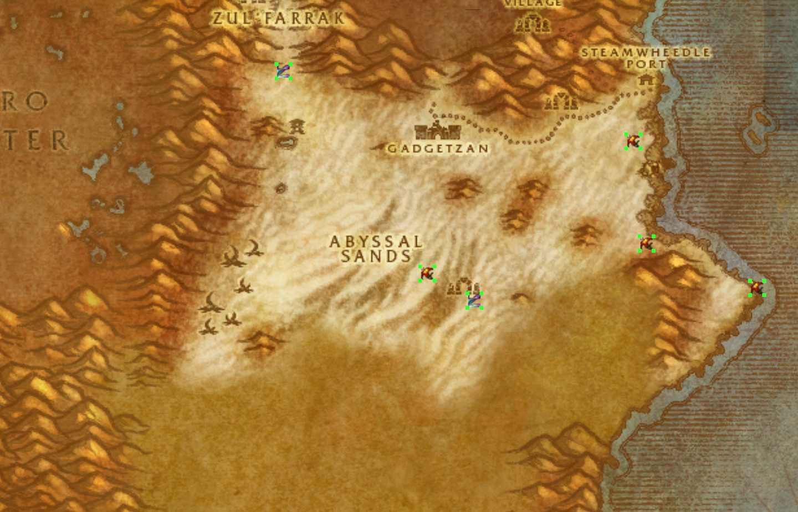
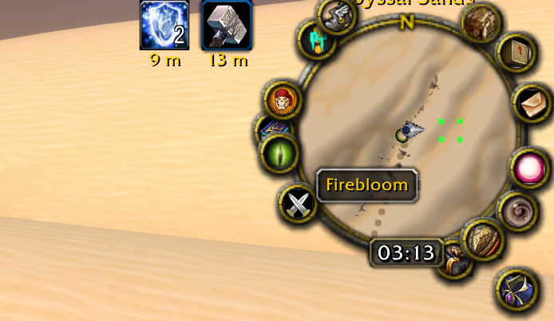
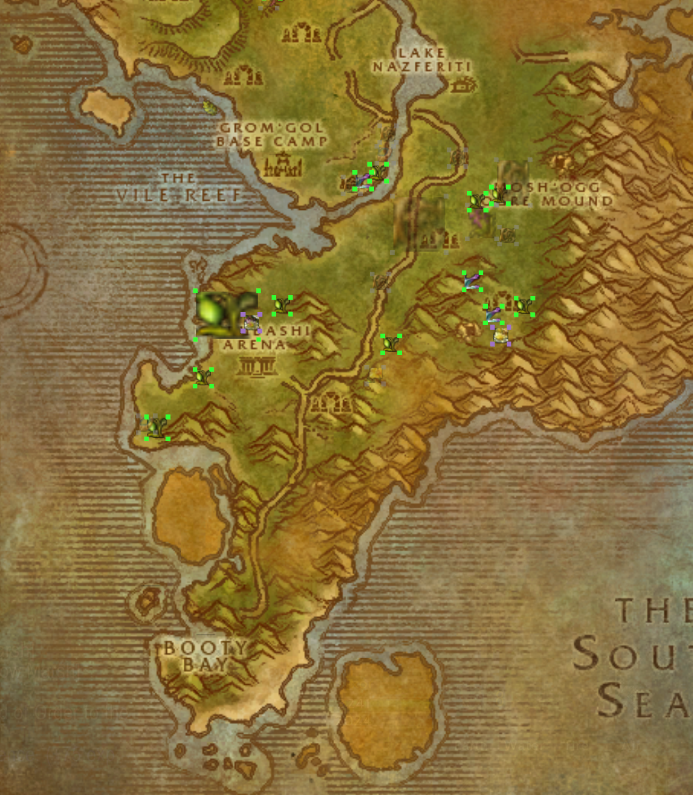
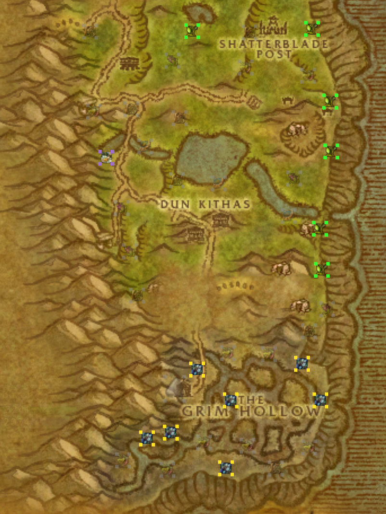

# Gather Map

**Forever-only port in development. The original 1.12 implementation is retained for historical reference.**

**Creator:** Babuni.dev  
**Addon version:** 0.4.3 · **Interface:** 11200 · **SavedVariables:** `GatherMapDB`  
**Implementation:** [`GatherMap.lua`](GatherMap.lua), [`GatherMap.toc`](GatherMap.toc)  
**Documentation audit:** 2026-10-26 — verified against source and Git history; **no new in-game tests performed**.

Gather Map remembers **where you successfully gathered resources** and shows those discoveries on both the minimap and zone world map. It started as a herbalism tool and grew into a broader record of herbs, minerals, custom Survival trees, skinned loot, lockpicking chests and ordinary treasure chests. The map learns as you play: **it does not import an authoritative catalog of currently available spawns**.

Instead of opaque dots, the overlay uses **four small difficulty-colored corner markers**. The world map also shows the associated resource icon. Markers re-evaluate against the *current character's* skill or level, while discoveries remain available across the account.



## Forever development status — 0.5.0-alpha (unreleased)

Development happens on [`feat/forever-port`](https://github.com/babunidev/GatherMap/tree/feat/forever-port) for **World of Warcraft Forever only** (target 1.60.1 / Interface `16001`).

**Implemented in source:** `GatherMap_Camelot.toc` loads `GatherMapData.lua`, `GatherMapMarkers.lua`, `GatherMapDifficulty.lua`, `GatherMapWorldPins.xml`, `GatherMapForever.lua` and `GatherMapCapture.lua` instead of the legacy runtime. The new shell reads effective profession ranks through `C_SkillInfo`, uses `C_Map` map IDs/positions, places four-corner pins with native map providers and `C_Minimap` radius, keeps independent map visibility controls, and retains the original same-resource merging logic. `Interact` is not a dependency for Forever.

**Step 3 source implemented, not in-game verified:** a separate `GatherMapCapture.lua` observes `UNIT_SPELLCAST_SUCCEEDED` and matching `LOOT_READY` sources before recording newly discovered resources. Herbs, minerals, skinned materials (approximate hunting spots), ordinary treasure and lockpicking are included. Failed, unconfirmed, stale and unrelated-source actions are rejected by design. **Recording defaults OFF** until explicitly enabled using `/gmap capture on`. Disable it with `/gmap capture off`, and inspect `/gmap capture status`.

**Step 4 difficulty implementation (not game-tested):** The new `GatherMapDifficulty.lua` reads the current character's skill lines through `C_SkillInfo` and includes rank, equipment modifiers, and temporary bonuses. It uses separately documented orange/yellow/green/gray thresholds for **28 herbs and 9 ore nodes** from Forever-specific community tables, instead of assuming every resource is separated by +25/+50/+100. Unsupported or unknown threshold tiers are purple, rather than guessed. Learned-profession filtering is independent from effective skill; ordinary treasure retains character-level colors. Skill changes and equipment/buff events trigger recomputation. Account-wide discoveries are unchanged; a different character calculates a different color from the same record. These behaviors have mock tests but still need actual Forever client confirmation. See [difficulty reference and limitations](docs/FOREVER_PORT.md).

**Step 5 display implementation (automated tests, not game-tested):** Four 3px colored corners remain on minimap and world-map pins, with the resource icon in the world-map center and 85% opacity for gray corners. A native map-canvas provider follows pan, zoom and resizing. Markers with the same kind and name merge transitively; different resources stay separate. A small independent hover label does not take control of the game's `GameTooltip`, clicks or map dragging. `/gmap on|off` changes only minimap pins; the world-map checkbox or `/gmap world on|off` changes only world-map pins. Both preferences persist in `GatherMapDB`. The world-map renderer rebuilds on relevant data/canvas changes, and minimap marker groups are cached while the viewpoint is unchanged. The cap remains 300 **displayed groups**, not discoveries. These behaviors have simulated geometry and UI-provider regression tests. Actual Forever map alignment and compatibility with other map addons remain unverified.

**Step 7 performance and reliability (source and CI-tested, not game-tested):** Minimap layout now uses a reusable world-coordinate spatial index for zones with at least 128 recorded entries, querying only nearby locations when the character moves. Dense marker grouping uses a representative per occupied cell rather than comparing every point with every nearby point. World-map groups are reused when map ID, canvas size, zoom and discovery/color revisions are unchanged; only the first 300 **displayed** groups stay in the layout cache. The original four-corner colors, transitive grouping and account-wide saved records remain unchanged. The capture switch avoids repeating identical chat notifications, malformed coordinates/counts are rejected rather than silently rewritten, and absent map APIs fail closed.

Mocked tests exercise 24,000 recorded locations, 12,000 densely overlapping markers, invalid records and another map provider. These are **synthetic CI tests**, not a gameplay FPS measurement or proof of compatibility with GatherMemory, Mapster, TomTom or customized minimaps in Forever. See [performance notes](docs/FOREVER_PORT.md).

**Step 6 migration (source implementation; live integrity not verified):** The separate `GatherMapMigration.lua` retains legacy `continent:zone` keys and copies discoveries to `map:<UiMapID>` only after a user manually links a historical zone while physically inside its matching Forever zone, reviews a preview and supplies `confirm`. The copier preserves original node records, restores v1 herb kinds and discards only *copied* v2 Skinning requirements, keeps schema-v3 metadata, merges matching counts and coordinates using weighted averages and stores snapshots before writing. It refuses ambiguous zones, duplicate imports and rollback if newer discoveries changed the destination. Unsupported and unmapped zones remain untouched. **Matching names does not prove matching coordinate geometry; visual validation is mandatory.** A separate `Backup-GatherMap.ps1` creates a physical saved-data backup with the game closed; the original OctoGather rename helper now explicitly selects the Forever TOC. See the [migration procedure](docs/FOREVER_PORT.md).

**Not implemented or verified:** fully automated conversion of legacy zone indexes, in-game map coordinate equivalence, physical save/reload after migration in Forever, actual gathering event signatures/ordering, localized tooltips, custom Forever resources and Survival/Woodcutting. Existing saved records remain untouched. The recorded observations use `map:<UiMapID>` keys; recording requires a successful player gathering spell and a matching loot source.

For an unsaved preview marker at your current position, use `/gmap testpin` and open the world map or inspect the minimap; use `/gmap clear` to remove it. `/gmap status` reports legacy versus modern data. These preview markers are never stored.

**Migration commands:** `/gmap migrate status`, `/gmap migrate link 1:2` (only while standing inside that historical zone's matching Forever zone), `/gmap migrate preview 1:2`, `/gmap migrate apply 1:2 confirm`, and `/gmap migrate rollback 1:2`. These are opt-in development tools; do not apply data before making a physical backup and verifying positions.

The original `GatherMap.toc` is still Interface `11200` / version `0.4.3` and is kept only as legacy history. The instructions below describe that old behavior; do not treat its gathering claims as verified Forever functionality. See [Forever compatibility notes](docs/FOREVER_PORT.md).

## What is recorded

| Resource kind | How it is learned | How color is determined | When it is visible |
| --- | --- | --- | --- |
| **Herbs** | Gather completion or recognized loot after Interact | Herbalism requirement | Current character has Herbalism |
| **Minerals** | Mining success, with some loot-to-node fallback | Mining requirement | Current character has Mining |
| **Survival trees** | Successful Woodcutting/recognized tree loot | Survival requirement | Current character has Survival |
| **Skinning** | Looted hide/leather/scale/item after skinning; saved as an approximate hunting spot | Requirement inferred from creature level | Current character has Skinning |
| **Lockpicking chests** | Recognized locked chest interaction | Lockpicking requirement | Current character has Lockpicking |
| **Ordinary chests** | Recognized world chest interaction | Known chest tier compared with character level | All characters |

The code associates a resource with a zone, subzone, map position, type, requirement where known, icon where available, and occurrence count. The main database is **account-wide**, but profession filtering and colors adapt to each character. **Skinning markers indicate places where a creature was skinned, not guaranteed stationary spawns.**

Custom resource tooltips can supply requirements; unknown requirements produce **purple** corners instead of an invented difficulty. A few known loot-to-node mappings are deliberately cautious: Thorium Ore alone cannot reveal a small versus rich Thorium vein.

## Two map presentations


### Minimap — subtle four-corner markers

Saved locations currently in range appear as four colored corners, with a hover label. The minimap visualization uses coordinates, zoom state, estimated scaling and custom-zone dimensions to position markers.



### World map — resource icons plus corners

When you open a specific **zone** on the world map, saved locations appear with their matching resource icon and corner dots. The **Gather Map** checkbox near the upper-left of the map toggles this overlay separately from the minimap. It remembers that setting.



Nearby markers for the **same resource kind and name** merge if their marker bounds overlap. Their four corner dots expand to the outside of the combined rectangle. Different resources do **not** merge. The rendering code caps each map at **300 displayed marker groups**; this is a display cap, **not a cap on saved discoveries**.

### Difficulty colors

| Color | Profession requirement compared with current skill |
| --- | --- |
| Red | Skill below the requirement |
| Orange | Skill meets the requirement, up to 24 points above |
| Yellow | 25–49 above |
| Green | 50–99 above |
| Gray | 100+ above |
| Purple | Requirement unknown |

For ordinary treasure, the algorithm compares the **chest tier to player level**, not profession skill: red at 6+ levels above; orange 3–5 above; yellow from 2 below through 2 above; green 3–9 below; gray 10+ below; unknown purple. Gray has **85% opacity**, the other categories 100%.

## Commands

| Command | Behavior |
| --- | --- |
| `/gathermap`, `/gathermap count`, `/gathermap status` | Show saved counts by type, profession skills and current zone support |
| `/gmap` | Alias for the same slash command family |
| `/gathermap on` or `show` | Show **minimap** markers |
| `/gathermap off` or `hide` | Hide **minimap** markers but continue recording discoveries |
| World-map **Gather Map** checkbox | Independently show/hide the **world-map** overlay |

The two visibility choices live in `GatherMapDB.enabled` and `GatherMapDB.worldMapEnabled`. Turning off minimap pins does **not** stop gathering or necessarily hide world-map pins.

## Install

1. Copy the project folder to `World of Warcraft/Interface/AddOns/GatherMap/`. Place `GatherMap.lua`, `GatherMap.toc` and `Icons/` inside that folder together.
2. Restart WoW, enable **Gather Map**, and use **Load out of date AddOns** if your particular 1.12-compatible client requires it.
3. Gather a recognized resource successfully, then run `/gmap count` and check the minimap/world map for the learned point.
4. Optionally install [Interact](https://github.com/lookino/Interact) for its hotkey behavior; Gather Map does **not require** it.

**Compatibility:** The TOC declares interface **11200**. The source includes additional outdoor/event map sizes for named custom zones; that is not proof every third-party 1.12 client has been verified. Several event strings, profession names, resource names and tooltip patterns are in English; **full localized-client support has not been demonstrated**.

## Supported custom maps

The current `customZoneSize` table contains **15** names: Hyjal, Scarlet Enclave, Lapidis Isle, Gillijim's Isle, Tel'Abim, Alah'Thalas, Gilneas, Icepoint Rock, Blackstone Island, Thalassian Highlands, Winter Veil Vale, Grim Reaches, Balor, Northwind and Moonwhisper Coast. The source has aliases including “Mount Hyjal” and “Island of Lapidis.” Subareas belonging to an existing Vanilla map may reuse their parent map's scaling.

A zone's presence in the table only establishes a **configured dimension**, not confirmed correct minimap alignment on every custom client.



## Upgrade if you used the old name

This project was originally named **Octo Gather**. Renaming the folder and saved-variable name does **not automatically migrate** old `OctoGatherDB` data into `GatherMapDB`.

With WoW **fully closed**, install `GatherMap` beside the old addon, open PowerShell in the new addon folder, and run the supplied migration helper with paths you supply:

```powershell
.\Upgrade-SavedData.ps1 -ClientPath "C:\Games\World of Warcraft" -PreviousAddonName "OctoGather"
```

The helper reads the old/new TOC declarations, scans saved-variable files, backs up sources in `AddonUpgradeBackups`, copies converted files to the new name, refuses existing destination files, and **does not execute saved Lua**. It leaves the original files in place. Disable the old addon, check the migrated data and retain the backups. The helper was executed only against disposable PowerShell fixtures, not against a real game installation. The add-on's *zone-key migration* is a separate, in-game process; `Upgrade-SavedData.ps1` handles the **OctoGather → GatherMap** name conversion only.

For non-Windows setups the older README includes a manual migration approach: back up your WTF SavedVariables first; copy old named SavedVariables files to the new name and change **only the top-level declaration** from the old TOC variable to `GatherMapDB`. Do not do this with WoW running.

For ordinary updates **without a folder/name change**, standard WoW SavedVariables persistence applies.

## How reliable is the data?

This is a **personal discovery record**, not a live-world sensing system. WoW's existing tracking dots may show a resource is currently spawned; Gather Map records places previously encountered. A failed cast should not create a node, but correctness depends on game event text, loot timing, tooltip availability and position APIs. The source contains debouncing and pending-state handling to reduce duplicates; these need client-level verification.

The current code polls map updates at approximately **0.10 seconds**, merges markers, and uses an upper display limit of 300 groups per map. Large saved databases, many custom zones, localized clients and interaction-hook load orders merit performance and compatibility tests.

The repo includes two regression-test scripts, **not an all-encompassing automated test suite**:
- `tests/test_interact_hook.py`: tests recursive Interact-hook behavior with **lupa / Lua 5.1** fixture code, not a live Vanilla client.
- `tests/test_upgrade.ps1`: tests migration from a synthetic previous addon name using temporary fixture directories.

Neither was executed during the 2026-10-26 documentation pass.

## Attribution and third-party source materials

The project **credits its creator Babuni.dev**. It also explicitly acknowledges:
- [Gatherer (Vanilla)](https://github.com/jsb/Gatherer) for coordinate scaling and bundled herb art.
- [MetaHunt](https://github.com/DuvelCorp/MetaHunt) for Grim Reaches map dimensions.
- [Interact](https://github.com/lookino/Interact) as an **optional** interoperability target, not a required embedded dependency.

These contributions must stay credited. The current repository tree has **no LICENSE file**. Public GitHub visibility and upstream asset credits do not by themselves establish permission to reuse all code or art; resolve licensing/provenance before packaging or redistributing third-party files.

## Project-development documentation

- [Concept](CONCEPT.md) · [Roadmap](ROADMAP.md) · [Changelog](CHANGELOG.md)
- [Architecture](docs/ARCHITECTURE.md) · [Interaction design](docs/DESIGN.md) · [Content and asset structure](docs/CONTENT.md)
- [Design decisions](docs/DECISIONS.md) · [Narrative development journal](docs/DEVLOG.md)
- [Human–AI collaboration](docs/AI_COLLABORATION.md) · [Developer/AI instructions](AGENTS.md)
