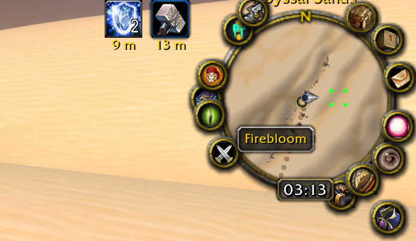
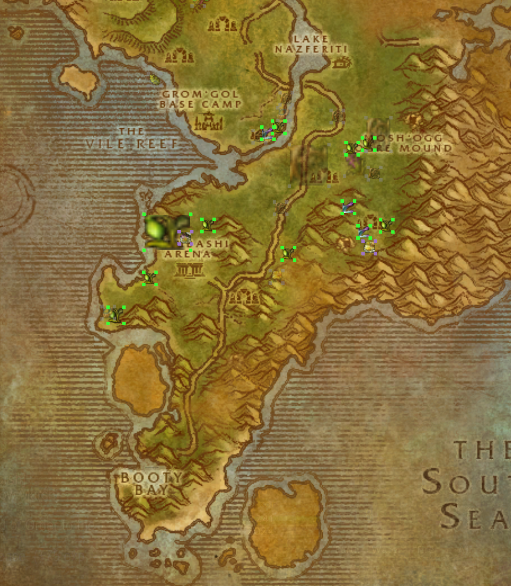

# GatherMap — visual, navigation and interaction design

**Creator and creative director:** Babuni.dev.

## A map that remembers, not a map that reveals everything

Gather Map begins with a subtle design decision: it learns **after discovery**. The overlay is a personal memory of gathering and exploring, so it should remain recognizable as an annotation layer on the game's own maps rather than pretending to know live spawns.

The work is not an alternative full-screen navigation app. It attaches to the native **minimap** and **world map**, retaining their familiar spatial context.

## Four corners, space in the middle

A small resource is marked by **four colored corner dots**, leaving its center mostly clear on the minimap. Historically these were 3-pixel flat squares; the November 5 Forever development uses small rounded illustrated textures displayed at 6×6 UI units. When the world map is open, a resource icon sits inside matching colored corners. The design moved here from early full rectangular outlines, with a visible September 7 commit documenting that choice.

Hovering uses a separate compact label frame so the map can display the resource name without competing with the native GameTooltip used during gathering. This is especially appropriate in a 1.12 UI, where tooltip behavior and mouse layers vary.

## Dynamic difficulty as a personal reading of the world

Red, orange, yellow, green, gray and purple are not static property labels printed on resources. They are interpretations relative to the **current character's skill or level**. Something once red can become gray as the player grows; an old account-wide discovery can become red again for a new character.

Purple is meaningful uncertainty: the addon cannot derive a requirement from its known table or an object tooltip. It avoids guessing. Gray uses **85% opacity**, a September adjustment from less legible variants.

Profession resources are hidden if the character doesn't know the corresponding skill. That keeps a low-level/new-profession minimap from becoming an irrelevant collection of everything the account has ever found. Ordinary treasure is the exception and can remain visible to any class.

## Grouping without erasing identity

Same-type and same-name markers merge when their drawn rectangles overlap. The group's four corners expand to the new overall bounds. If multiple nearby nodes have different requirements, the group's strongest difficulty priority is used. Resources with different names/types remain separate even when they overlap.

This prevents the visual clutter of duplicate marks without collapsing distinct types into meaningless giant boxes.

## Controls and affordances

The minimap overlay is governed by `/gmap on` / `off`, while `/gmap world on` / `off` changes the world-map overlay. Both settings are stored. The **GatherMap** button at the upper-left corner of the world map opens a compact panel with independent switches for minimap markers, world-map markers, gathering recording and diagnostic chat. No display toggle deletes discoveries or changes recording; recording starts OFF and must be enabled explicitly.

The status command prints total saved points, type counts, skill ranks and whether the current zone has known scaling. This makes the system slightly diagnosable without introducing another settings window.

## Forever map presentation checkpoint (November 4, 2026)

The existing four-corner design is retained: 3px corner dots, no central minimap icon, a small resource icon on world-map markers, transitive visual grouping for matching kinds/names, and 85%-opacity gray. The new Forever map uses Blizzard's native map-canvas pins rather than an independent overlay on the old `WorldMapButton`.

The cursor label is a private, mouse-disabled miniature tooltip. It avoids interfering with Blizzard's GameTooltip while gathering and leaves map click/drag handling alone. Minimap and world-map switches retain their original independent scope and SavedVariables. A 300-group display limit does not discard recorded discoveries.

Lua fixtures cover grouping and mathematical positions at different zooms, sizes and UI scales. **The live Forever appearance is not yet approved or verified:** screenshots, clipping under custom minimap masks, city/zone maps and other map addons still require actual client tests. These tests are about fidelity to the existing design, not permission to redesign it.

## November 5 — compact settings menu

After the first Forever installation showed the world-map checkbox but no new discoveries, the map control was changed to a small **GatherMap** button that opens four ON/OFF rows. This makes the previously separate recording policy visible alongside the two display controls. The optional diagnostic toggle controls temporary chat detail, while a short last-capture result appears in the panel. This menu does not redesign the four-corner marker language, and retains independent saved preferences. Its layout and click behavior are currently verified only with mocked UI frames.

## November 5 — illustrated difficulty dots

Babuni selected six subtly textured, rounded corner-dot images for the new Forever markers. They were generated with AI art tools under this direction, then cropped into six compact transparent **16×16 RGBA TGA** assets. The four corners remain **independent 6×6 image textures** anchored to the same invisible marker frame: the center is still clear, and nearby identical discoveries still merge into square or rectangular group frames. Red/orange/yellow/green/gray/unknown-purple show difficulty without text; gray retains 85% marker opacity. Native world-map resource icons remain inside the corners.

This is a **texture replacement**, not a nine-slice redesign or a change to saved observations. The intention is stronger legibility and less apparent corner shimmer, but whether it improves actual Forever pixels is unverified until tested.

## Areas requiring genuine user testing

- Dense nodes vs. 300-group drawing cap.
- Different minimap sizes, UI scaling and indoor/outdoor zoom.
- Readability of colored 6px illustrated corner dots and 85%-opacity gray in varying environments.
- Hover zones and mouse-layer conflicts with other minimap addons.
- Whether skinning hunting areas need their own visual distinction from stationary herbs and ore.
- Whether hidden-profession defaults match the creator's preferred exploration style.

These are evaluation questions, **not** an approved redesign or a claimed accessibility test.
